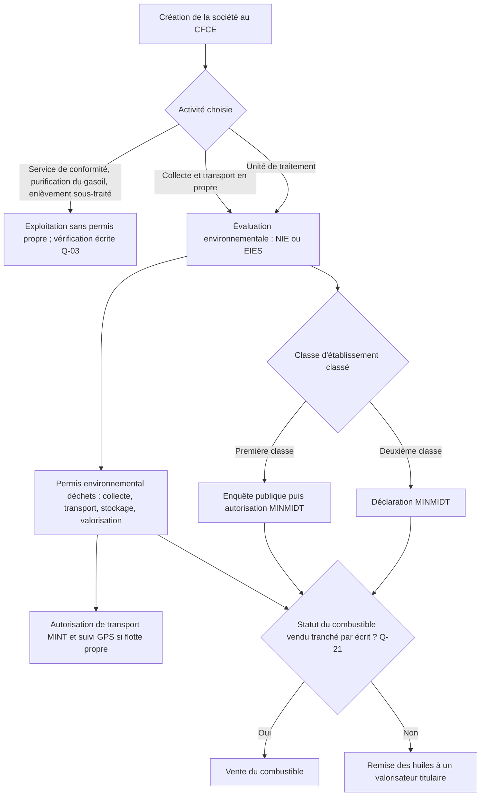

# Lot 2 : cadre réglementaire et autorisations

Méthode : pyramide de Minto pour la conclusion ; le cadre juridique et institutionnel est rédigé en texte, conformément à la règle 7.

**Rôles mobilisés :** juriste en droit de l'environnement camerounais, juriste OHADA et fiscaliste, logisticien transport de matières dangereuses, contre-expert.

**Avertissement de méthode.** Aucun texte cité ici n'a été lu en entier : le réseau de travail bloque les PDF officiels (Q-02). Chaque texte est donc « connu par résumé » (notice FAOLEX, presse, mémoire universitaire). Les conclusions ci-dessous doivent être confirmées par un juriste sur les textes officiels avant tout dépôt.

## 1. Conclusion

La société peut démarrer sans permis si elle se limite au service de conformité (formation, registres, fûts, rapport PGES), à la purification du gasoil et à la sous-traitance de l'enlèvement à un collecteur agréé. Certitude : probable.

Dès qu'elle collecte, transporte, stocke ou traite elle-même des huiles usagées, elle cumule au moins trois titres : une évaluation environnementale approuvée, le permis environnemental « déchets » du MINEPDED et, pour un site de traitement, le régime des établissements classés du ministère chargé des mines et de l'industrie. Le délai réaliste avant exploitation d'une unité de traitement va de 6 à 25 mois (`calendrier.md`, cas bas et haut).

Sur la question ouverte : la valorisation figure bien dans la définition du permis donnée par l'article 1 de l'arrêté n°001/MINEPDED du 15 octobre 2012 [S-02]. Elle peut donc être autorisée par ce permis, à condition d'être expressément demandée et mentionnée. Mais le permis ne règle pas le statut du produit vendu : aucun texte camerounais trouvé ne dit quand une huile traitée cesse d'être un déchet. Tant que ce point n'est pas tranché par écrit, l'acheteur qui brûle le combustible risque d'être regardé comme éliminant un déchet dangereux sans titre. C'est le premier risque réglementaire du modèle « unité de traitement ». Certitude : probable sur le permis, supposé sur le statut du produit.

## 2. Cadre juridique

### 2.1 Textes internationaux

Le Cameroun est partie à la convention de Bâle du 22 mars 1989 sur le contrôle des mouvements transfrontières de déchets dangereux et de leur élimination, et à la convention de Bamako du 30 janvier 1991 sur l'interdiction d'importer en Afrique des déchets dangereux. Une source secondaire date la ratification de Bâle du 11 février 2001 et celle de Bamako du décret n°93/302 du 22 octobre 1993 [S-39]. Ces dates sont à confirmer auprès du dépositaire. Les deux conventions ont trois effets concrets pour le projet : l'exportation d'huiles usagées ou de résidus vers un pays tiers suit la procédure de consentement préalable ; l'expédition d'échantillons vers un laboratoire étranger doit être vérifiée au regard de ces procédures (Q-14) ; l'importation d'huiles usagées pour alimenter une unité est exclue.

### 2.2 Lois

La loi n°89/027 du 29 décembre 1989 porte sur les déchets toxiques et dangereux [S-39]. La loi n°96/12 du 5 août 1996 portant loi-cadre relative à la gestion de l'environnement fixe les principes de gestion des déchets et les sanctions pénales aux articles 79 à 87 [S-23][S-24]. La loi n°98/015 du 14 juillet 1998 régit les établissements classés dangereux, insalubres ou incommodes et renvoie leur nomenclature à un texte réglementaire [S-35].

### 2.3 Décrets

Le décret n°2012/2809/PM du 26 septembre 2012 fixe les conditions de tri, de collecte, de transport, de récupération, de recyclage, de traitement et d'élimination finale des déchets. Il couvre les déchets industriels, commerciaux et artisanaux [S-31]. Son intitulé cite le recyclage et le traitement : la valorisation entre donc dans le champ de la réglementation des déchets.

Le décret n°99/818/PM du 9 novembre 1999 fixe les modalités d'implantation et d'exploitation des établissements classés. L'autorisation d'exploitation de première classe suit une enquête publique ouverte par le ministre chargé des établissements classés, qui nomme des commissaires-enquêteurs. La deuxième classe relève d'une déclaration préalable [S-35].

Le décret n°2013/0171/PM du 14 février 2013 fixe les modalités de réalisation de l'étude d'impact environnemental et social, de l'évaluation environnementale stratégique et de la notice d'impact environnemental [S-33].

### 2.4 Arrêtés

L'arrêté n°001/MINEPDED du 15 octobre 2012 fixe les conditions d'obtention du permis environnemental en matière de gestion des déchets. Son article 1 définit ce permis comme le document qui autorise une personne physique ou morale à exercer le tri, la collecte, le transport, le stockage et la valorisation des déchets (extrait FAOLEX tronqué) ; le permis est délivré par le ministre chargé de l'environnement. Son chapitre II traite des conditions propres aux déchets toxiques ou dangereux et vise le tri, la collecte, le transport et l'élimination finale [S-02]. Le cahier des charges du promoteur indique une quittance de 200 000 FCFA, une caution de 2 000 000 FCFA, 60 jours d'instruction et une validité de 5 ans [S-29] : ces valeurs n'ont pas été retrouvées dans les extraits consultés (Q-01).

L'arrêté n°002/MINEPDED du 15 octobre 2012 sur la gestion des déchets industriels toxiques ou dangereux est cité par le cahier des charges [S-29]. Aucun extrait n'a été trouvé (Q-02).

L'arrêté n°00001/MINEPDED du 8 février 2016 fixe les catégories d'opérations soumises à évaluation environnementale stratégique ou à EIES. L'extrait disponible mentionne la gestion des déchets, notamment les installations de stockage ou de destruction, sans dire si une unité de traitement d'huiles usagées relève de l'EIES sommaire ou détaillée [S-34] (Q-23). L'arrêté n°0002/MINEPDED du 9 février 2016 fixe le canevas des termes de référence et le contenu de la notice d'impact environnemental [S-42].

La décision n°0108/D/MINEF/CAB du 9 février 1998 sur les normes d'intervention en milieu forestier est citée par le cahier des charges [S-29]. Elle encadre les pratiques des exploitants forestiers, dont la gestion des huiles et carburants sur les chantiers ; son texte n'a pas été consulté.

### 2.5 Cadre institutionnel

Le ministère de l'Environnement, de la Protection de la Nature et du Développement durable (MINEPDED) délivre le permis environnemental déchets, approuve les évaluations environnementales et contrôle leur mise en œuvre [S-02][S-33]. Le ministère des Mines, de l'Industrie et du Développement technologique (MINMIDT) est le ministère chargé des établissements classés : Cameroon Tribune désigne le ministre des Mines comme destinataire des demandes [S-35], et le MINMIDT contrôlait en juillet 2026 les agréments relatifs aux études de danger, plans d'urgence et contrôles de pollution des établissements classés [S-36]. Certitude : probable. Le ministère des Transports (MINT) délivre l'autorisation de transport routier de marchandises dangereuses [S-37]. Le ministère des Forêts et de la Faune (MINFOF) contrôle les exploitants forestiers et l'application des normes d'intervention. La Commission de surveillance des prix des produits pétroliers fixe les prix à la pompe [S-09]. La Bourse nationale des déchets, société d'économie mixte créée en 2025, organise la mise en relation des producteurs et des valorisateurs [S-10][S-11].

## 3. Autorisations, dans l'ordre

Les durées réelles sont des hypothèses (H-70 à H-74) ; leur enchaînement est calculé dans `calendrier.md`.

### 3.1 Immatriculation de la société

Autorité : Centre de formalités de création d'entreprises (CFCE). Pièces : statuts (lot 11), pièces d'identité, déclaration de non-condamnation, justificatif de siège. Coût et délai : H-30 et H-70, à confirmer (Q-08). Obligations : déclarations fiscales et sociales.

### 3.2 Évaluation environnementale

Autorité : MINEPDED. Réalisée par un bureau d'études agréé autre que HIKMA (contrainte d'éthique). Catégorie à faire confirmer par écrit (Q-23) : notice d'impact pour un centre de transit et de conditionnement, EIES sommaire ou détaillée pour une unité de traitement. Pièces : termes de référence, rapport, consultations publiques selon la catégorie. Coût : honoraires du bureau d'études et frais d'examen, non publiés (Q-27). Délai : H-71. Obligations : mise en œuvre et rapports de suivi du PGES.

### 3.3 Permis environnemental déchets dangereux

Autorité : ministre chargé de l'environnement [S-02]. La demande doit lister expressément chaque opération : collecte, transport, stockage et valorisation. Pièces et frais : à confirmer sur le texte officiel (Q-01). Délai : H-72. Obligations probables : registre des entrées et sorties, bordereaux de suivi, rapports périodiques, contrôles.

### 3.4 Établissement classé

Autorité : ministre chargé des établissements classés, probablement le MINMIDT [S-35][S-36]. Si l'installation est de première classe : enquête publique et autorisation ; si elle est de deuxième classe : déclaration [S-35]. La classe dépend de la nomenclature, non retrouvée (Q-22). Pièces probables : étude de dangers, plan d'urgence, plans du site. Délai : H-73. Obligations : inspections, contrôle des appareils à pression le cas échéant.

### 3.5 Transport routier

Si la société exploite sa propre flotte : permis environnemental couvrant le transport (3.3) et autorisation de transport de marchandises dangereuses du MINT, dont le coût publié diverge selon la source, 100 000 FCFA ou 200 000 FCFA par an [S-37]. Le MINT impose depuis 2024 un suivi GPS aux transporteurs de produits pétroliers et dangereux [S-38]. Aucun texte rendant l'accord européen ADR applicable au Cameroun n'a été trouvé : ses règles (signalisation, équipement, formation des chauffeurs) servent de référence de bonne pratique au lot 6, sans valeur obligatoire démontrée.

### 3.6 Importation d'équipements

Autorité : douanes. Les droits et taxes relèvent du tarif extérieur commun de la CEMAC. Le bénéfice des incitations de la loi n°2013/004 du 18 avril 2013 est instruit au lot 4 ter. Aucun extrait consulté ne permet de chiffrer les droits par équipement (Q-28).

### 3.7 Mise sur le marché du combustible

Aucune norme camerounaise de combustible issu d'huiles usagées n'a été trouvée (Q-26). Deux questions restent ouvertes : le moment où le produit cesse d'être un déchet (Q-21) et l'éventuel régime des produits pétroliers applicable à la vente d'un combustible liquide (Q-24). En attendant, la spécification est contractuelle (lot 5) et le contrat de vente prévoit que l'acheteur détient les titres nécessaires pour brûler le produit.

## 4. Logigramme des démarches

## 5. Sanctions encourues par les clients

Les montants légaux sont connus par sources secondaires et doivent être vérifiés sur le texte officiel de la loi n°96/12 [S-24] (Q-19).

- Article 80 de la loi n°96/12 : introduction de déchets toxiques ou dangereux sur le territoire, amende de 50 à 500 M FCFA et peine de prison [S-23]. Ce cas ne vise pas les producteurs locaux d'huiles usagées.
- Article 81 : amende de 10 à 50 M FCFA et emprisonnement de deux à cinq ans selon une source secondaire, pour des infractions relatives aux déchets [S-23]. L'infraction exacte visée doit être vérifiée.
- Article 82 : pollution, dégradation des sols ou altération de la qualité de l'air ou des eaux, emprisonnement de six mois à un an ; les bornes de l'amende sont incohérentes dans la source secondaire [S-23].
- Article 87 : exclusion du sursis et des circonstances atténuantes pour ces infractions [S-23].
- Transaction administrative : le montant peut être fixé en concertation avec l'administration des finances et descendre sous le minimum légal [S-23].

Les sanctions réellement payées par les clients forestiers ne sont pas publiques. Le protocole 4 bis n°4 les relève. Tant qu'il n'a pas abouti, l'argumentaire commercial cite les plafonds légaux vérifiés, jamais un montant moyen.

## 6. Obligations d'exploitation à prévoir dans le kit (lot 15)

- registre chronologique des entrées et sorties de déchets ;
- bordereau de suivi par enlèvement, signé par le producteur, le transporteur et le destinataire ;
- fiche d'analyse par lot ;
- rapport annuel au MINEPDED et rapports de suivi du PGES ;
- plan d'urgence et exercices, si établissement classé ;
- suivi GPS des véhicules de transport [S-38].

Le contenu exact de chaque obligation sera aligné sur le texte officiel de l'arrêté n°001 dès sa réception (Q-01).

## 7. Contre-expertise

**Rôle : contre-expert.**

Les trois hypothèses les plus fragiles :

1. **La valorisation peut être couverte par le permis déchets.** Elle repose sur un extrait tronqué de l'article 1. Le chapitre II, propre aux déchets dangereux, ne vise que le tri, la collecte, le transport et l'élimination finale. Une lecture restrictive du MINEPDED fermerait la voie du permis pour la valorisation.
2. **Le service de conformité n'exige aucun titre.** Si l'administration considère la fourniture de fûts, la tenue des registres et la coordination des enlèvements comme une « gestion » de déchets, la société a besoin du permis dès le départ.
3. **Le délai central de 12 mois avant exploitation d'une unité.** Il dépend d'une enquête publique dont la durée réelle n'est pas connue, et de la catégorie d'évaluation environnementale.

Scénario d'échec : la société investit dans l'unité, obtient son permis, mais le MINEPDED considère que le combustible reste un déchet dangereux. Les industriels refusent de l'acheter faute de titre propre. La production s'accumule en stock.

**Ce que la synthèse change en conséquence.** Le modèle « unité de traitement » ne peut pas être retenu au lot 8 avant une réponse écrite du MINEPDED sur Q-01 et Q-21. La lettre au MINEPDED du lot 0 est complétée par ces deux questions. Le premier modèle chiffré au lot 9 sera celui qui n'exige pas de titre pour le produit.

## 8. Points faibles du livrable

1. Aucun texte n'a été lu en entier : toutes les conclusions sont au mieux « probables ».
2. Les frais, pièces et délais officiels du permis, de l'évaluation environnementale et de l'établissement classé restent inconnus.
3. La nomenclature des établissements classés et la catégorie d'évaluation environnementale du projet ne sont pas établies.
