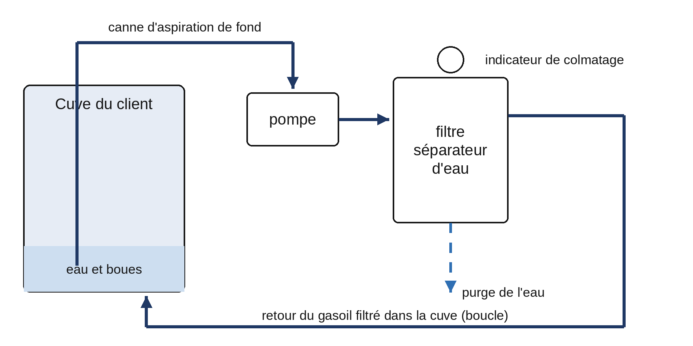
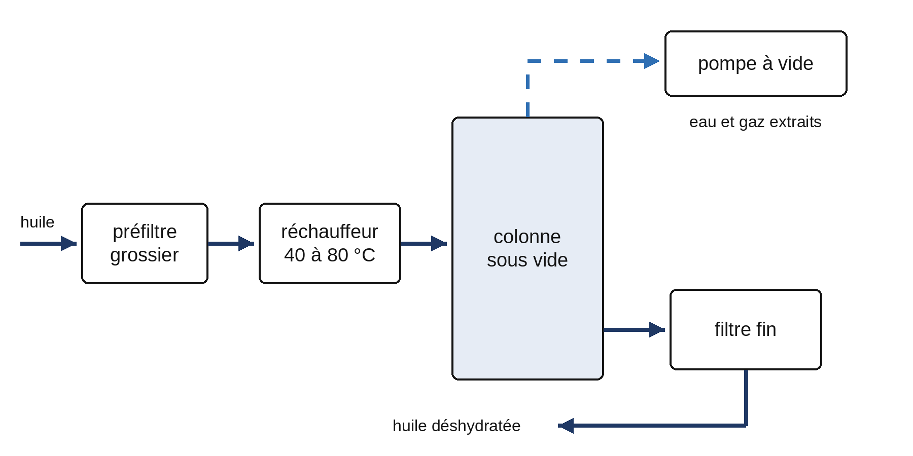
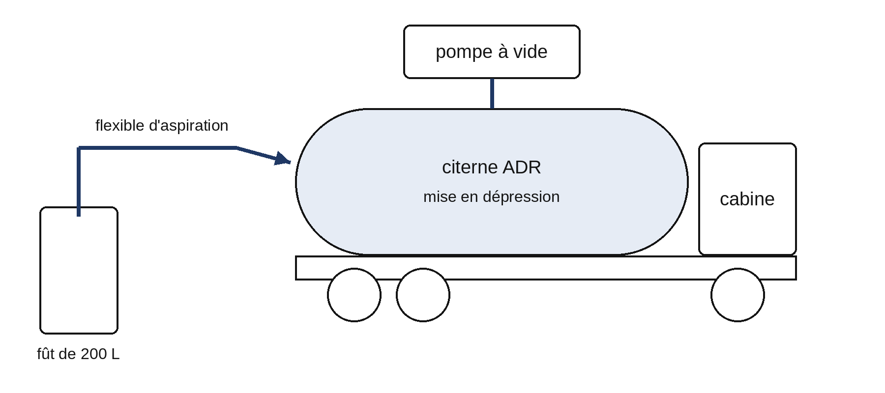

# Dossier technique des équipements

## Objet et périmètre

Le dossier décrit les équipements de la société de gestion des huiles usagées et de purification du gasoil, rangés par étape de sa trajectoire (décision D-09). Il accompagne en annexe le document de projet institutionnel et le business plan bancaire. Il sert de base aux demandes de prix, à la demande d'offre de crédit-bail et, à l'étape 3, à la description des installations dans l'évaluation environnementale.

Les caractéristiques citées sont celles publiées par les fabricants et leurs revendeurs : ce sont des déclarations commerciales, à confirmer par devis. Aucun devis n'a encore été reçu ; aucun distributeur au Cameroun n'a été identifié pour les marques citées, sauf Toyota.

| Code | Équipement | Étape | Mode d'acquisition |
|---|---|---|---|
| E1 | Purificateur de gasoil portable | étape 1 | location au pilote, puis crédit-bail |
| E2 | Purificateur d'huile sous vide | étape 4 | achat après la porte de l'étape 4 (D-06) |
| E3 | Appareil de point éclair Pensky-Martens en vase clos | étape 4 | achat ; laboratoire sous-traitant avant |
| E4 | Kits de dépistage des halogènes dans les huiles usagées | étape 0 | achat, consommable |
| E5 | Matériel de prélèvement | étape 0 | achat |
| E6 | Camion hydrocureur ADR d'occasion pour huiles usagées | étape 3 | achat d'occasion (D-10), location avec chauffeur en dépannage |
| E7 | Véhicule léger 4x4 pick-up | étape 1 | location, puis crédit-bail |

Étapes : 0 amorçage et pilote ; 1 matériel loué, enlèvements sous-traités ; 2 équipement en crédit-bail ; 3 permis propre et camion ; 4 traitement, sous les conditions de la décision D-06.

## Principe de fonctionnement

### Purification du gasoil

Le gasoil est aspiré au fond de la cuve du client, traverse un élément qui retient les particules et sépare l'eau, puis revient dans la cuve. L'opération se fait à froid, en boucle, sans entrée en cuve. L'eau purgée et les éléments usagés sont des déchets gérés comme les huiles usagées.

Source : schéma de principe établi pour le projet d'après les fiches Parker et Donaldson [S-92][S-93].

### Déshydratation sous vide

L'huile préfiltrée est chauffée, puis passe dans une colonne sous vide où l'eau et les fractions légères s'évaporent à basse température ; une filtration fine termine le traitement. Le procédé ne retire ni les additifs dégradés, ni les métaux dissous : il ne transforme pas une huile moteur usagée en huile neuve ni en carburant.

Source : schéma de principe établi pour le projet d'après la fiche Pall HNP [S-95] et le bilan matière du lot 5.

### Collecte par citerne sous vide

La pompe met la citerne en dépression ; l'huile est aspirée depuis le fût sans passer par la pompe, ce qui tolère l'eau, les boues et les débris des fûts forestiers.

Source : schéma de principe établi pour le projet d'après les annonces de camions hydrocureurs [S-101].

## Fiches équipements

### E1 Purificateur de gasoil portable

| Rubrique | Contenu |
|---|---|
| Fonction | Purificateur de gasoil portable, quantité : 1 |
| Spécifications minimales | débit d'au moins 60 L/min ; séparation de l'eau et filtration des particules (élément séparateur d'eau) ; alimentation 220 V monophasé, 50 Hz ; indicateur de colmatage ; joints compatibles gasoil ; flexibles d'aspiration et de refoulement d'au moins 5 m, canne d'aspiration de fond |
| Référence recommandée | Parker Racor DFC14WS25VVX1 [S-73] ou DFCC14WS10VVX1 [S-92] : 60 L/min, séparation de l'eau, élément FBO-14, pompe à engrenages |
| Alternatives | Donaldson Clean Diesel Cart X011431 [S-93] ; HYDAC LowViscosity Unit LVU-CD [S-94] |
| Étape et mode d'acquisition | étape 1 ; location au pilote, puis crédit-bail |
| Points de vigilance | la fiche Parker indique 60 Hz : exiger la version 50 Hz ; l'élément absorbant Donaldson sature avec l'eau, prévoir un stock d'éléments |

### E2 Purificateur d'huile sous vide

| Rubrique | Contenu |
|---|---|
| Fonction | Purificateur d'huile sous vide, quantité : 1 |
| Spécifications minimales | débit nominal de 10 L/min (600 L/h) au moins ; chauffage réglable de 40 à 80 °C ; déshydratation sous vide, eau résiduelle garantie sur huile moteur usagée ; préfiltration grossière et filtration fine ; sécurités : surchauffe, niveau, manque de vide ; essai sur échantillon réel fourni par l'acheteur avant commande |
| Référence recommandée | Pall HNP022 ou HNP023 [S-95] : déshydratation sous vide, appareil portable |
| Alternatives | HYDAC FluidAqua Mobile [S-94] ; série TYA chinoise (Chongqing TOP, Zhongneng, Rexon) [S-96], après essai sur notre huile |
| Étape et mode d'acquisition | étape 4 ; achat après la porte de l'étape 4 (D-06) |
| Points de vigilance | le procédé retire l'eau et les particules, pas les additifs dégradés ni les métaux ; essai sur 20 L d'huile réelle et analyse indépendante avant toute commande |

### E3 Appareil de point éclair Pensky-Martens en vase clos

| Rubrique | Contenu |
|---|---|
| Fonction | Appareil de point éclair Pensky-Martens en vase clos, quantité : 1 |
| Spécifications minimales | méthode ASTM D93 ; fonctionnement automatique ; détection de l'éclair automatique ; certificat d'étalonnage |
| Référence recommandée | Anton Paar PMA 500 [S-97] : ASTM D93, détection automatique, extincteur intégré |
| Alternatives | Stanhope-Seta PM-93 [S-98] ; Koehler, appareil automatique |
| Étape et mode d'acquisition | étape 4 ; achat ; laboratoire sous-traitant avant |
| Points de vigilance | la révision ASTM D93-25 impose une vérification par matériaux de référence certifiés [S-98] ; godet standard en laiton |

### E4 Kits de dépistage des halogènes dans les huiles usagées

| Rubrique | Contenu |
|---|---|
| Fonction | Kits de dépistage des halogènes dans les huiles usagées, quantité : 20 |
| Spécifications minimales | seuil de réponse à 1 000 ppm de chlore ; méthode ASTM D5384 ; date de péremption d'au moins 12 mois à la livraison |
| Référence recommandée | Dexsil Clor-D-Tect 1000 [S-99] : seuil de 1 000 ppm de chlore, ASTM D5384, EPA 9077 |
| Alternatives | Dexsil Clor-D-Tect Q4000 [S-99] : mesure de 200 à 4 000 ppm |
| Étape et mode d'acquisition | étape 0 ; achat, consommable |
| Points de vigilance | biais positif au-delà de 3 % de soufre : tout lot positif est confirmé au laboratoire ; réactifs périssables |

### E5 Matériel de prélèvement

| Rubrique | Contenu |
|---|---|
| Fonction | Matériel de prélèvement, quantité : 1 lot |
| Spécifications minimales | canne de prélèvement de fût sur toute la hauteur ; échantillonneur COLIWASA ; 50 flacons en verre ambré de 500 mL à bouchon à joint PTFE ; étiquettes et scellés numérotés ; glacière |
| Référence recommandée | échantillonneur COLIWASA Nasco ou Wheaton [S-100], flacons ambrés à bouchon PTFE, scellés numérotés |
| Alternatives | gamme Blackburn Sampling ; Koehler K27400 [S-28] |
| Étape et mode d'acquisition | étape 0 ; achat |
| Points de vigilance | un flacon par lot, scellé et étiqueté avant transport au laboratoire |

### E6 Camion hydrocureur ADR d'occasion pour huiles usagées

| Rubrique | Contenu |
|---|---|
| Fonction | Camion hydrocureur ADR d'occasion pour huiles usagées, quantité : 1 |
| Spécifications minimales | citerne sous vide conforme ADR, compatible hydrocarbures ; pompe à vide (à palettes ou à anneau liquide) avec protection contre le débordement de la citerne ; flexibles d'aspiration d'au moins 10 m et canne pour fûts de 200 L ; vidange par gravité et par mise en pression ; équipements de sécurité et signalisation ; historique d'entretien de la pompe et du porteur ; visite technique valide ; garantie mécanique d'au moins 3 mois |
| Référence recommandée | camion hydrocureur ADR à citerne sous vide d'environ 13 000 L, porteur IVECO, MAN ou DAF [S-101] |
| Alternatives | porteur avec citerne compartimentée et pompe de transfert |
| Étape et mode d'acquisition | étape 3 ; achat d'occasion (D-10), location avec chauffeur en dépannage |
| Points de vigilance | agrément ADR, état de la pompe à vide, inspection avant achat ; autorisation de transport du MINT [S-37] ; prix rendu Douala inconnu (Q-44) |

### E7 Véhicule léger 4x4 pick-up

| Rubrique | Contenu |
|---|---|
| Fonction | Véhicule léger 4x4 pick-up, quantité : 1 |
| Spécifications minimales | 4x4, double cabine ; plateau avec arrimage pour le purificateur et des fûts vides ; réseau de pièces et d'entretien en Afrique centrale |
| Référence recommandée | Toyota Hilux double cabine, distribué par CAMI, groupe CFAO [S-102] |
| Alternatives | pick-up 4x4 équivalent avec réseau de pièces en Afrique centrale |
| Étape et mode d'acquisition | étape 1 ; location, puis crédit-bail |
| Points de vigilance | plateau avec points d'arrimage et bac de rétention ; offre de crédit-bail à demander avec la lettre B4 |

## Matériel de terrain

| Matériel | Référence recommandée | Caractéristique publiée |
|---|---|---|
| Bac de rétention pour 4 fûts | DENIOS base-line en polyéthylène [S-103] | 255 L de rétention |
| Kit antipollution | DENIOS DENSORB, version hydrocarbures [S-103] | absorbants hydrophobes, version mobile sur chariot |
| Pompe de transfert | Graco Husky 1050, pneumatique à membrane [S-104] | version UL décrite pour le gasoil et les huiles ; certification ATEX du modèle exact à confirmer |

Chaque site client reçoit des fûts identifiés sur bac de rétention et un kit antipollution ; ces fournitures sont comprises dans le contrat annuel de conformité.

## Exigences HSE et réglementaires

| Domaine | Exigence | Équipements concernés |
|---|---|---|
| Transport de marchandises dangereuses | agrément ADR de la citerne, licence de transport du MINT [S-37], suivi GPS [S-38] | E6 |
| Atmosphères explosives | matériel électrique adapté au gasoil près des cuves ; pompe à certification ATEX à vérifier | E1, pompe de transfert |
| Métrologie | vérification par matériaux de référence certifiés selon ASTM D93-25 [S-98] | E3 |
| Déchets | huiles contaminées par des halogènes refusées et éliminées séparément ; éléments filtrants usagés gérés comme déchets dangereux [S-02] | E1, E2, E4 |
| Installation | évaluation environnementale du centre de transit par un bureau indépendant [S-33] ; autorisation d'établissement classé [S-35] | E2, E3, E6 |

## Plan d'acquisition

| Étape | Contenu | Mode | Montant prévu (M FCFA) | Hypothèse | État du devis |
|---|---|---|---:|---|---|
| 0 et pilote | matériel de prélèvement (E5) ; les kits de dépistage (E4) sont comptés dans les consommables | achat | 0,2 | H-45 | aucun devis |
| 0 et pilote | purificateur de gasoil (E1), 3 mois | location | 1,2 | H-47 | aucun devis |
| 1 | dépôts de garantie, premiers loyers et petit matériel pour le purificateur (E1) et le véhicule (E7) | location ou crédit-bail | 4,0 | H-93 | aucun devis |
| 1 à 5 | loyers de crédit-bail et de location, par an | loyers | 6,0 | H-94 | demande B4 à envoyer |
| 2 | purificateur, matériel d'échantillonnage, véhicule, stock de fûts et kits | crédit-bail | 15,0 | H-92 | demande B4 à envoyer |
| 3 | camion hydrocureur ADR d'occasion (E6) | achat d'occasion | 30,0 | H-131 | aucun devis (Q-44) |
| 3 et 4 | centre de transit : cuves, décanteur, déshydrateur (E2), laboratoire de base (E3), permis | achat | 45,0 | H-95 | aucun devis |

Source : registre des hypothèses du projet ; les montants sont des hypothèses centrales, sans devis.

Les montants des étapes 3 et 4 ne sont engagés qu'au franchissement des portes de décision ; ils ne font pas partie du financement demandé à la banque.

## Points à confirmer

1. Existence et prix d'une version 50 Hz des chariots Parker (Q-16).
2. Prix rendu Douala d'un camion hydrocureur ADR d'occasion et coût de sa mise en conformité (Q-44).
3. Distributeurs en Afrique centrale de Parker, Donaldson, Pall, HYDAC, Anton Paar et Dexsil, avec délais et service après-vente.
4. Résultat d'un essai de déshydratation sur 20 L d'huile usagée locale, analysé par un laboratoire indépendant, avant tout achat d'un appareil de l'étape 4.
5. Certification ATEX du modèle exact de pompe de transfert.
