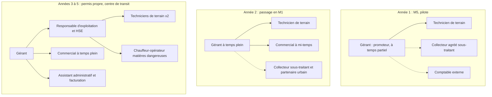

# Lot 10 : organisation

Méthodes : organigramme par étapes calé sur la trajectoire D-09, comparaison des salaires de marché sourcés (`masse_salariale.md`, générée par le code), pyramide de Minto pour la conclusion.

**Rôles mobilisés :** entrepreneur PME en Afrique centrale, expert HSE, analyste financier, contre-expert.

## 1. Conclusion

La société démarre avec deux personnes (le promoteur, encore salarié de HIKMA, et un technicien), passe à quatre au passage en M1, et à sept environ en année 5 si le permis propre est obtenu. Certitude : supposé.

La comparaison avec les salaires de marché (`masse_salariale.md`) montre que le modèle financier est prudent pour le technicien et le commercial, mais qu'il paie le gérant 46 % sous la référence d'un responsable HSE. Ce sous-paiement est un choix de fondateur, tenable deux à trois ans. À partir de l'année 4, porter le gérant au prix du marché réduit le résultat avant impôt de l'année 5 d'environ 6 M FCFA : la différence de coût employeur, environ 0,5 M FCFA par mois, sur 12 mois. L'écart est compatible avec le scénario de base du lot 9 (34 M FCFA de résultat net en année 5).

## 2. Organigramme sur 5 ans

| Poste | Année 1 | Année 2 | Année 3 | Année 4 | Année 5 | Déclencheur |
|---|---:|---:|---:|---:|---:|---|
| Gérant | 0,5 | 1 | 1 | 1 | 1 | passage en M1 (porte de l'étape 1) |
| Technicien de terrain | 1 | 1 | 1 | 2 | 2 | au-delà de 10 clients sous contrat |
| Commercial | 0 | 0,5 | 0,5 | 1 | 1 | passage en M1, puis 10 clients |
| Responsable d'exploitation et HSE | 0 | 0 | 0 | 1 | 1 | obtention du permis propre |
| Chauffeur-opérateur matières dangereuses | 0 | 0 | 0 | 1 | 1 | achat du camion-citerne (D-10) |
| Assistant administratif | 0 | 0 | 0 | 0,5 | 1 | plus de 15 contrats à facturer |

Le modèle financier du lot 9 ne porte que les trois premiers postes. Les postes des années 4 et 5 sont liés à l'étape 3 (permis propre) et devront être ajoutés au modèle quand cette étape sera déclenchée.

## 3. Fiches de poste

### 3.1 Gérant

**Mission :** diriger la société, vendre les contrats de conformité aux grands comptes, tenir la relation avec les administrations, garantir la conformité HSE et la prévention du conflit d'intérêts avec HIKMA. **Activités :** prospection et négociation, rapports PGES annuels des clients, dossiers d'autorisation, pilotage financier, recrutement. **Profil :** ingénieur, compétences HSE et EIES ; c'est le profil du promoteur [S-29]. **Rattachement :** assemblée des associés.

### 3.2 Technicien de terrain

**Mission :** réaliser les interventions chez les clients. **Activités :** purification du gasoil et nettoyage de cuve depuis l'extérieur, prélèvements et dépistage des halogènes, contrôle des fûts et des registres, accompagnement des enlèvements sous-traités, saisie dans l'application. **Profil :** BTS ou DUT en maintenance, mécanique, chimie ou HSE ; permis B ; 2 ans d'expérience en atelier d'engins ou en station-service ; disponibilité pour des missions d'une semaine en forêt. **Rattachement :** gérant, puis responsable d'exploitation.

### 3.3 Commercial

**Mission :** développer le portefeuille de clients forestiers, d'UTB et de flottes urbaines. **Activités :** plan de prospection des 50 cibles (lot 15), rendez-vous, propositions, suivi des renouvellements, veille concurrentielle. **Profil :** licence en commerce ou formation technique, 3 ans de vente en B2B industriel (lubrifiants, pièces, services aux engins). **Rattachement :** gérant.

### 3.4 Responsable d'exploitation et HSE (étape 3)

**Mission :** exploiter le centre de transit sous permis et le transport en propre. **Activités :** planning des tournées, réception et acceptation des lots, registre et bordereaux, plan d'opération interne, formation et exercices, relations avec les inspecteurs. **Profil :** ingénieur ou licence professionnelle HSE, 5 ans d'expérience en site industriel ou pétrolier ; certification NEBOSH IGC souhaitée.

### 3.5 Chauffeur-opérateur matières dangereuses (étape 3)

**Mission :** conduire le camion-citerne et réaliser le pompage chez les clients. **Profil :** permis poids lourd, expérience du transport d'hydrocarbures, formation aux matières dangereuses, aptitude médicale.

### 3.6 Assistant administratif et facturation (étape 3)

**Mission :** facturation trimestrielle d'avance des contrats, relances, paie, archivage des bordereaux. **Profil :** BTS en comptabilité ou gestion, maîtrise d'un tableur.

## 4. Annonces de recrutement

### 4.1 Technicien de terrain (recrutement au mois 3)

> **Technicien de terrain, gestion des carburants et des huiles usagées (H/F), Yaoundé avec missions en forêt.**
> Société camerounaise de services environnementaux aux exploitants forestiers et aux industries. Vous réalisez la purification du gasoil et le contrôle des huiles usagées chez nos clients, en respectant nos procédures HSE.
> Profil : BTS ou DUT en maintenance, mécanique, chimie ou HSE ; 2 ans d'expérience en atelier d'engins, en station-service ou en maintenance industrielle ; permis B ; disponible pour des missions d'une semaine.
> Nous offrons : contrat à durée indéterminée après période d'essai, déclaration à la CNPS, équipements de protection, formation aux procédures et à la sécurité.
> Candidature : CV et lettre à [adresse], avant le [date].

### 4.2 Commercial B2B (recrutement au passage en M1)

> **Commercial B2B, services environnementaux (H/F), à mi-temps puis temps plein, Douala ou Yaoundé.**
> Vous développez un portefeuille d'exploitants forestiers, d'unités de transformation du bois et de flottes d'entreprises pour nos contrats de conformité (gestion des huiles usagées, purification du gasoil, dossiers d'audit).
> Profil : 3 ans de vente B2B industrielle (lubrifiants, pièces, services aux engins) ; aisance avec les directions techniques ; permis B.
> Rémunération : fixe et variable sur les contrats signés.
> Candidature : CV et lettre à [adresse], avant le [date].

Les annonces des postes de l'étape 3 suivront le même format.

## 5. Salaires

Voir `masse_salariale.md`. Les références publiées sont minces : une fourchette Paylab pour les techniciens, construite sur moins de 20 répondants vérifiés, et une fourchette de guide pour les responsables HSE [S-86] ; une moyenne du secteur formel à Douala [S-87]. Aucune référence n'a été trouvée pour les chauffeurs poids lourd. Le SMIG du secteur privé est donné de manière contradictoire selon les sources ; le seul texte récent identifié fixe celui des agents de l'État relevant du Code du travail à 43 969 FCFA [S-88]. Les salaires du lot 10 sont tous très au-dessus de ce minimum.

## 6. Plan de formation

| Module | Public | Durée | Contenu | Moment |
|---|---|---|---|---|
| F1 Dangers des huiles usagées et des carburants | tous | 1 jour | composition, toxicité, HAP et métaux, incendie, EPI, hygiène | embauche |
| F2 Procédures de la société | techniciens, chauffeur | 2 jours | réception et acceptation des lots, dépistage Clor-D-Tect, prélèvement, purification du gasoil, bordereau, application mobile | embauche |
| F3 Intervention en cas de déversement | techniciens, chauffeur | 1 jour | confinement, absorbants, obturation, alerte, fiche d'incident, exercice pratique | embauche, puis annuel |
| F4 Espaces confinés et nettoyage de cuve | techniciens | 1 jour | permis d'entrée, détection de gaz, ventilation, surveillant, sauvetage ; principe du nettoyage depuis l'extérieur | avant la première intervention en cuve |
| F5 Lutte contre l'incendie et premiers secours | tous | 1 jour | extincteurs, émulseur, gestes de premiers secours | embauche, puis tous les 2 ans |
| F6 Transport de matières dangereuses | chauffeur, responsable d'exploitation | 2 à 3 jours | signalisation, équipement du véhicule, conduite sur piste, documents de bord ; référence ADR | avant l'étape 3 |
| F7 Réglementation et conformité des clients | gérant, commercial | 1 jour | textes du lot 2, obligations du producteur, bordereau, rapport PGES, audits FSC et OLB | embauche |
| F8 Vente de services de conformité | commercial | 1 jour | argumentaire, grille tarifaire, objections, éthique et conflit d'intérêts | embauche |

Les modules F1 à F5 sont animés par le gérant (certifié NEBOSH IGC [S-29]) ; F6 par un organisme spécialisé (Q-40).

## 7. Contre-expertise

**Rôle : contre-expert.**

1. **Hypothèse fragile : le gérant accepte d'être payé 46 % sous le marché.** Si le promoteur ne peut pas quitter HIKMA sans un revenu équivalent, la société doit supporter un coût de gérant plus élevé dès l'année 2.
2. **Hypothèse fragile : un technicien suffit jusqu'à 10 clients.** Avec une intervention de purification par client et par trimestre à deux mois, et une semaine de tournée par cycle d'enlèvement, la charge d'un seul technicien approche la saturation autour de 8 à 10 clients.
3. **Hypothèse fragile : le marché offre des techniciens disposés à partir une semaine en forêt.** Le turnover peut être élevé.

Scénario d'échec : le technicien unique part au mois 9, en plein pilote ; le promoteur, encore chez HIKMA, ne peut pas assurer les interventions, et le pilote échoue pour une raison qui n'a rien à voir avec le marché.

**Ce que la synthèse change en conséquence.** Le gérant et le technicien sont formés tous deux à toutes les interventions ; un second technicien est identifié et formé en vivier avant la fin du pilote ; une prime de fidélité au technicien est liée au renouvellement des contrats pilotes.

## 8. Points faibles du livrable

1. Les références salariales sont peu nombreuses et faiblement fondées ; aucune pour les chauffeurs poids lourd.
2. Les autres prélèvements sur salaires et l'impôt sur le revenu ne sont pas intégrés au coût employeur (Q-39).
3. Le dimensionnement des effectifs n'est pas tiré d'un plan de charge chiffré.
